# PERCH — Autonomous Insect Capture in a Simulated Room

## Latest interception simulation

[**Watch PERCH_INTERCEPTION.mp4 — the most up-to-date interception simulation**](media/PERCH_INTERCEPTION.mp4)

This repository develops the **detection, pursuit and capture** system for PERCH, a miniature drone intended to catch flying pests indoors.

## Capture task

The drone **waits on a perch**. When it detects an insect, it **takes off and attempts to intercept it**. After a miss, it keeps pursuing and tries again. The chase ends if the insect has been **lost for more than 3 seconds**.

The simulated insect measures **7 mm in diameter by default** (adjustable from **5 to 20 mm**).

A capture counts only when **both** conditions are met:
1. The drone comes **within 2 cm** of the insect.
2. Its **snapping basket** is triggered **within the 200 ms before reaching that distance**, or while the insect is within range.

Approaching within 2 cm without a timely basket trigger is a **miss**.

The system investigates insect-inspired **STMD** (Small-Target Motion Detector) algorithms for detecting/tracking insects and **LGMD** (Lobula Giant Movement Detector) algorithms for detecting looming objects and timing the basket trigger.

**Roadmap:** This repository covers capture. Another will address **spatial navigation**, and a third will integrate both in simulation. Once the integrated simulation works, the goal is a **Crazyflie-class drone with a Prophesee event camera**, weighing **less than 50 g in total**. The algorithms must fit its onboard computing resources.

## Interception and LGMD detection

PERCH can pursue the same insect through multiple approaches, including after a missed interception. As the distance to the target repeatedly falls, the **LGMD collision detector** identifies imminent contact and triggers the snapping capture basket. A capture is counted when the basket is triggered **within 200 ms before impact** (the insect passing within **2 cm** of PERCH).

### Full-length simulation sequences

Three independent 20 fps flights showing the onboard visual stream and the drone/insect trajectories.


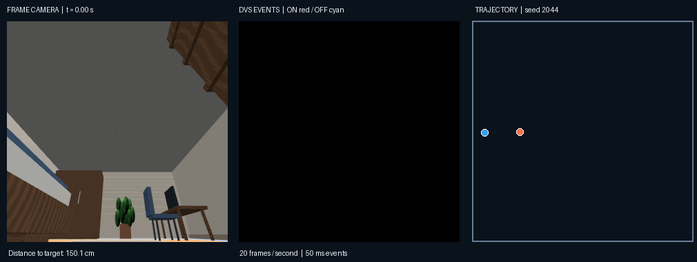

### LGMD performance

The benchmark includes **30 furnished-room simulations**, with each insect starting approximately 150 cm from PERCH and runs lasting up to 20 seconds. A **pass** is an approach within 10 cm; a **capture** additionally requires the insect to reach 2 cm and an LGMD basket trigger within the preceding 200 ms.

| Metric | Result |
|---|---:|
| Simulations | **30** |
| Total close passes (within 10 cm) | **70** |
| Passes reaching the 2 cm capture range | **37** |
| Simulations with at least one captured pass | **18/30 (60.0%)** |
| Captured passes | **22** |
| Success rate per pass | **22/70 (31.4%)** |
| False triggers outside the valid window | **3** |
| Total LGMD basket triggers | **25** |
| Closest approach across simulations | **0.28–9.56 cm** |
| Median closest approach per simulation | **1.46 cm** |

Across **22 successful LGMD triggers**, the detector fired on average **79 ms before entering the 2 cm capture range** (median 73 ms; range 32–180 ms). For the **20 encounters with a recorded exit**, it fired on average **153 ms before leaving that range** (median 137 ms; range 83–304 ms); the remaining two exits could not be measured reliably.

Each simulation's closest distance, 10 cm close-pass count, 2 cm entries, and capture result is recorded in the [per-simulation results](results/lgmd_20261108/lgmd_simulation_summary.csv). The [pass-by-pass results](results/lgmd_20261108/lgmd_pass_summary.csv) include individual trigger timing and missed opportunities.

### Repeated interception attempts and LGMD activation

The distance to the insect drops repeatedly as PERCH makes several interception attempts. **Green activation bars** show LGMD-triggered basket closures timed for a catch; the **red bar** shows a false alarm. Each activation lasts **50 ms** (one recorded time step). The dashed line marks the 2 cm impact range.

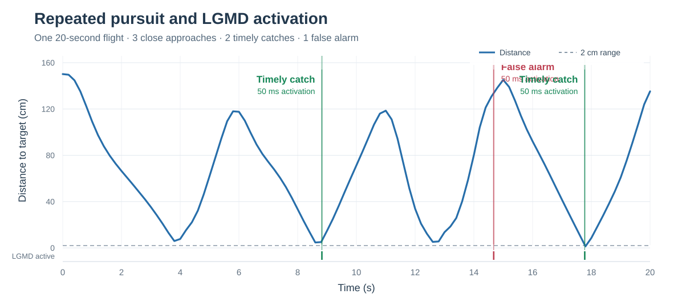

## 3D environment

A furnished **7 × 6.2 × 2.8 m bedroom**. External views hide the walls and ceiling to show the layout; the simulated onboard cameras render the enclosed room.

| View 1 | View 2 | View 3 |
|:--:|:--:|:--:|
| 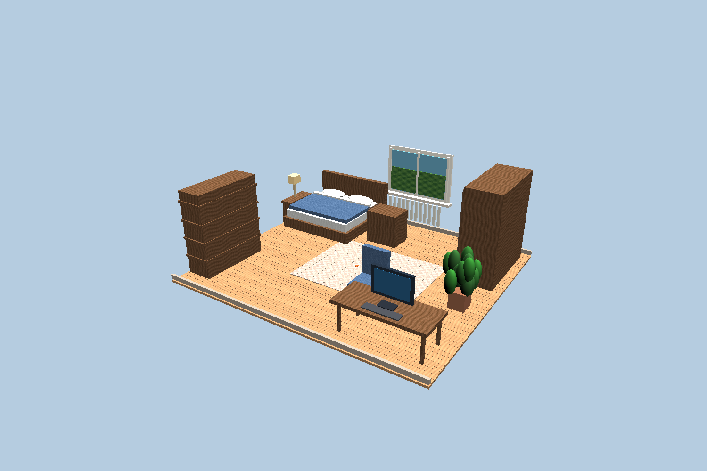 | 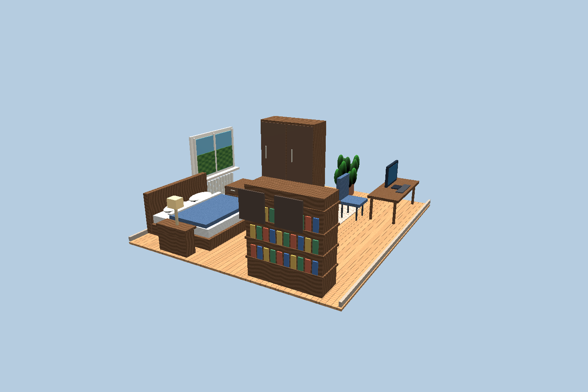 | 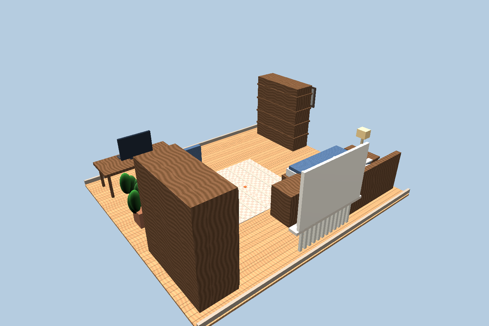 |

**B** is the drone's starting base; **P1–P3** are proposed perches; **R1–R3** are restricted areas. Their coordinates are in [`config/sites.json`](config/sites.json).

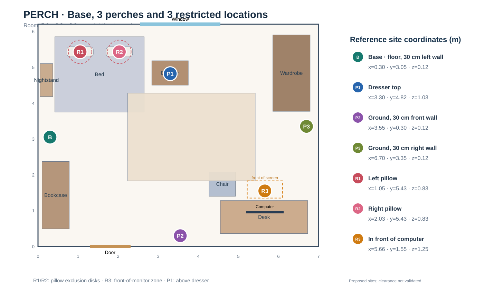

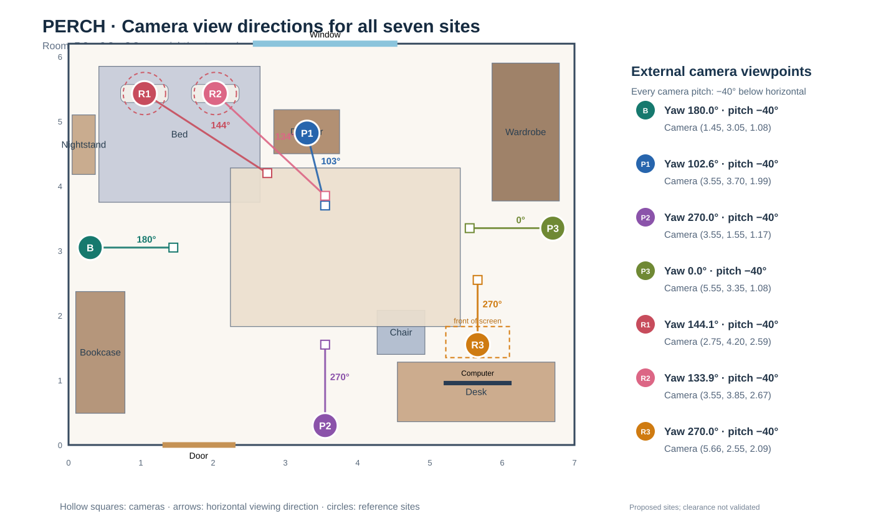

## Simulated visual sensors

### 360° panorama

The panoramic camera covers **360° horizontally × 110° vertically** at **360 × 100 pixels**.

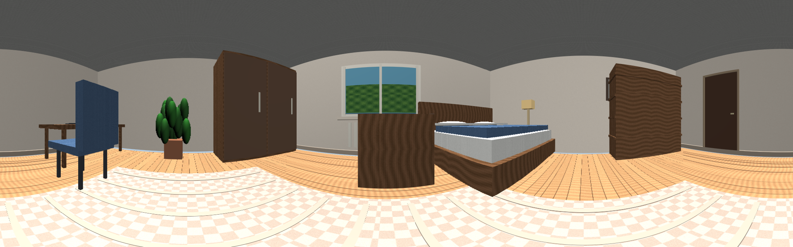

### Prophesee GENX320 reference

The proposed **Prophesee GENX320 event camera** has **320 × 320 pixels** (image resolution). The simulated camera's **84° × 84°** value is its **horizontal × vertical field of view**, not its resolution. The image is a render, not a real camera recording.

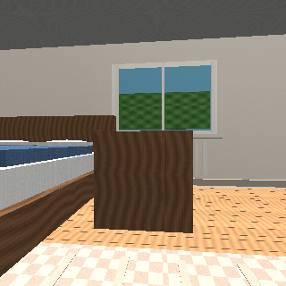

### Four synchronized views: RGB and DVS

A **5-second simulated flight at 20 Hz** (one sample every 50 ms), displaying two camera formats and their simulated event outputs:

| | Panoramic camera | Prophesee-style camera |
|---|---|---|
| **Top: RGB frames** | 360 × 100 | 320 × 320 |
| **Bottom: DVS events** | Panoramic brightness changes | Forward-view brightness changes |

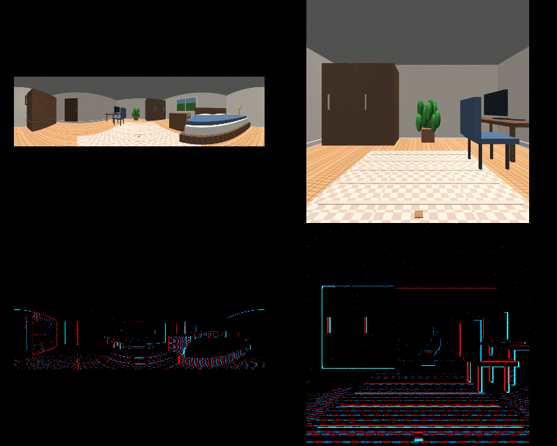

**DVS** represents changes in brightness: **red** = increase (ON), **cyan** = decrease (OFF), **black** = no event. This animation demonstrates visual input, not an insect capture.

## Static STMD detection at base B

PERCH remains **stationary at base B** and observes flying insects with its **320 × 320, 84° × 84°** forward camera at **20 Hz**.

The **STMD detector** combines two filters: the first detects small, dark objects (roughly one pixel across), while the second detects motion. Together, they allow the drone to detect and track small moving objects, such as flying insects. [Detector code](src/stmd_singlebank.py) · [Reproducible experiment](experiments/stmd_static_20runs.py).

### Example: 7 mm insects starting 50 cm and 150 cm from B

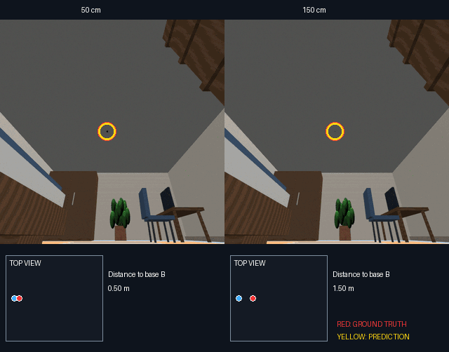

**Left: 50 cm. Right: 150 cm. Red: ground truth. Yellow: prediction.** The minimaps and trajectories are for visualization only; the STMD model does not compute them. STMD estimates only the direction of the insect.

### Detection accuracy vs distance

The benchmark uses **20 independent 10-second flights per target size (5, 7 and 20 mm) and starting distance (10 cm, then 25–200 cm in 25 cm steps)**: 540 trials in total. A detection is correct when the insect is visible, its response passes the detector's calibrated threshold, and its angular localization error corresponds to less than **5% of target range**.

**Accuracy versus actual PERCH–insect distance (10 cm–7 m):**

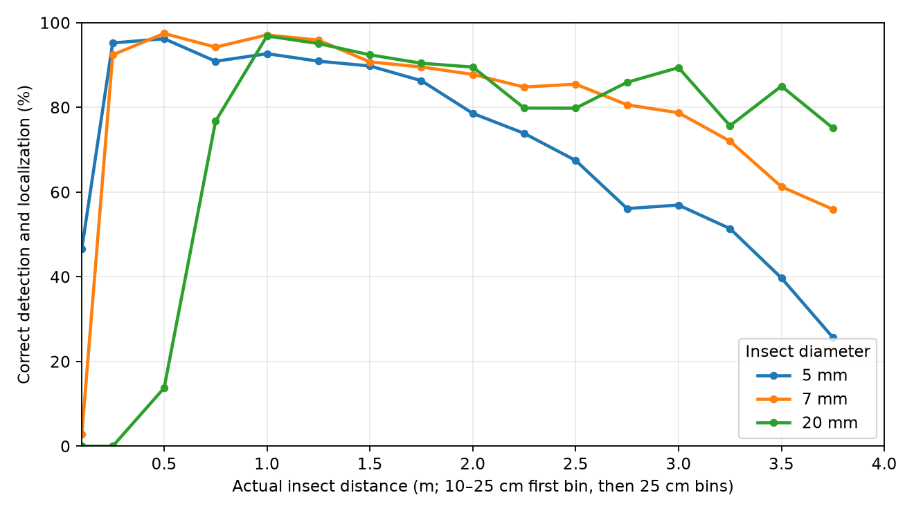

[Accuracy by starting distance](results/stmd_base_B_8x1_20runs/accuracy_by_start_distance.png) · [Measured data](results/stmd_base_B_8x1_20runs/accuracy_by_actual_distance.csv)

Accuracy is the percentage of visible frames with a correct detection and localization, **not** capture success.

### Processing cost (first STMD implementation, 320 × 320)

| Metric | Result |
|---|---|
| Measured CPU processing time | **8.91 ms/frame average** (9.62 ms at the 95th percentile), on a GitHub Actions x86 CPU |
| Retained directional memory | **3.28 MB** (eight 320 × 320 float32 activity maps) |
| Total RAM requirement | **Above 3.28 MB** with camera, background and temporary buffers; peak RAM has not been measured |
| Candidate processor | **STM32N657**: 800 MHz Arm Cortex-M55, **4.2 MB on-chip SRAM** |
| Estimated STM32N657 processing time | **20–100 ms/frame** (estimated, not measured) |

**This is a first, unoptimized Python/OpenCV implementation and must be optimized for embedded deployment.** The 8.91 ms desktop measurement excludes rendering and simulation physics. A 320 × 320 grayscale frame alone needs 0.10 MB; the retained 3.28 MB activity bank leaves only about 0.92 MB of the STM32N657's on-chip SRAM for image buffers, additional algorithm state, the firmware and other tasks. An embedded port will therefore need careful buffer reuse and likely lower-precision or reduced-resolution motion maps. The 20–100 ms estimate is deliberately approximate: performance will depend on C/C++ implementation, SIMD/vectorization, image filtering, memory traffic and buffer layout, and **must be validated on the STM32N657**. The chip's AI accelerator should not be assumed to accelerate these hand-coded STMD filters without a specific implementation.

STM32N657 hardware specifications: [STMicroelectronics](https://www.st.com/en/microcontrollers-microprocessors/stm32n657x0.html). Measured desktop timing: [previous repository profile](https://github.com/thomasMisiek/Neural_Learning_Flight/blob/main/media/PERCH_8dir_processing_profile.json).

## Continuous camera tracking

PERCH continuously adjusts its camera direction to keep a detected insect in view.

**Example: continuous tracking of a flying 7 mm insect from base B (real-time, 20 fps).**

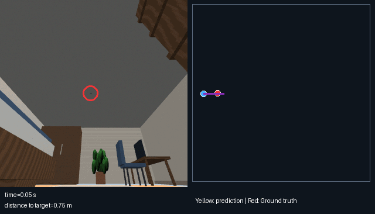

These simulations demonstrate that PERCH can continuously track a flying insect from base B.

**Note:** The insect can be difficult or impossible to see in some frames of the repository GIFs because video compression obscures such a small target.

## Run the room simulation

```bash
pip install -r requirements.txt
python src/bedroom.py --output media
python -m unittest discover -s tests -v
```
